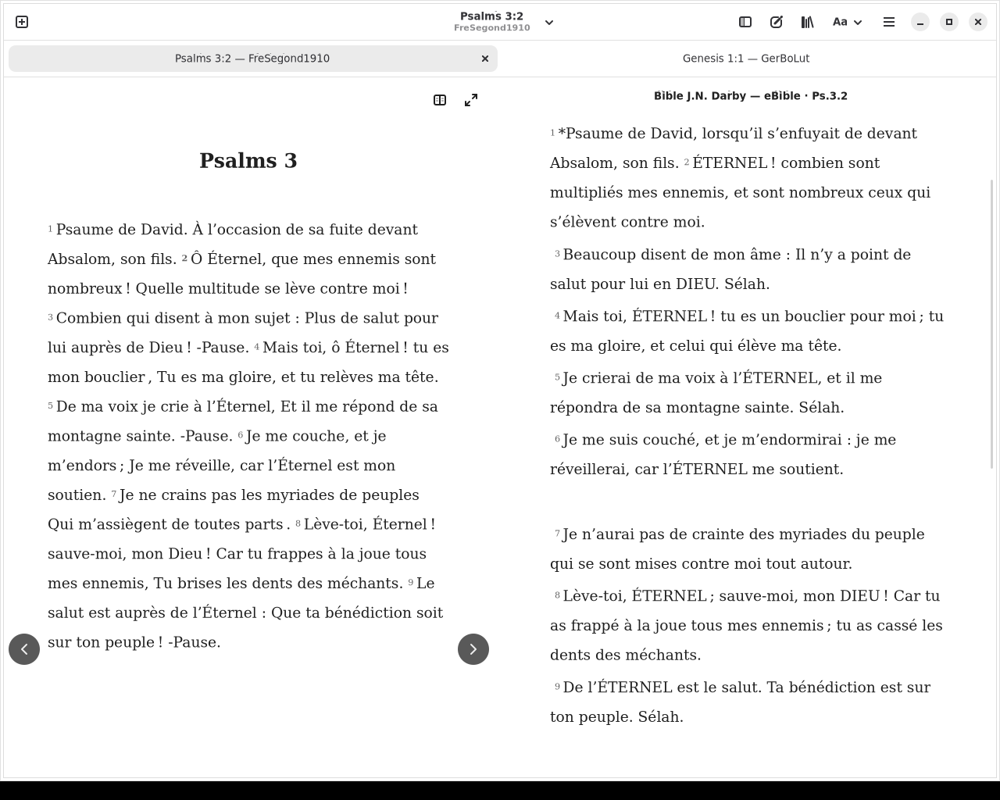

# Comparison interoperability (#57)

## Corrected behavior

The actual signed alpha at source `87b9803` reproduced empty comparison panes
for eBible JND/Darby (`frajnd2024eb` 2.17, zText, Luther). German and NRSVA
also lacked native cross-system mapping; each resource was readable alone.
The [resumption report](COMPARISON_57_RESUMPTION.md) identifies that package,
exact resources, native source and upstream revision. Installation (#56) is a
separate problem; this work does not bypass catalogue/package validation.

Comparison now resolves these systems through reference-only JSword tables,
expanded by the original pinned parser. Runtime SWORD canon dimensions must
match the entire table before implicit identities are permitted. Existing
native-to-native mappings remain unchanged. No resource-name, language or
provider exceptions are used. KJVA is the common intermediate; KJV's shorter
canon is checked explicitly. Native-only systems can bridge through their
verified native KJVA mapping; a verse part that cannot be represented exactly
by that bridge remains unsupported.

Duplicate associations, verse parts, absent sections and one-to-many mappings
are retained. Whole intermediate groups are composed **verse by verse** through
the reverse table, rather than copying a whole range's coordinates. The original
top-level JSword mapper sometimes bypasses reverse verse mappings for ranges
and throws on a qualified multi-verse range. Bible deliberately avoids its
range-identity fallback; the latter case remains explicitly unsupported. This
is a documented adaptation, not a claim of byte-identical top-level behavior.

The current consumer can represent a contiguous target interval. Disjoint
results, introductions without a normal target verse, absent entries, unknown
mapping capabilities and qualified multi-verse ranges produce an explicit local
limitation. They are never filled, truncated or guessed. A readable comparison
stays available in its own canon, clearly labelled **Independent reading**;
initially it opens its first actual passage, or retains its own existing passage.
It does not reuse an unmapped printed source reference. A later deliberate
scroll can resume following only after a verified mapping succeeds.

The comparison cache includes the primary resource/system, so changing only
the primary Bible at the same printed reference clears obsolete errors and
recalculates Psalm targets. Queued following work cannot outlive its input
lease. Missing/unreadable resources clear their reader and document state so
later gestures cannot operate on an old resource. Commentary following retains
its separate coordinator.

## Source and independent data checks

- Full native source suite: **180 passed**, including six focused comparison/
  mapping tests and existing notes, highlights, sessions, commentary and UI tests.
- Pinned JSword mapping tests: **39 passed**, separate from Bible's suite.
- All **14** exported tables reproduce byte for byte from the included original
  source archive. Full native SWORD canons match every exported canon.
- Independent Java `map`/`unmap` calls with explicit verse-by-verse group
  composition agree with the table bridge on **604,575** cases: all explicit
  exceptions plus chapter starts/ends, across differing systems needing the
  new capability. The **21** qualified-range combinations remain unsupported.
  This checks reference-table composition, not the existence of every possible
  verse in every installed Bible. 150 independent vectors are retained as tests.
- Offline source GTK: **49 ordered pairs** of seven real resources at John 3:16,
  11 numbering/boundary/range cases, five native bidirectional wheel pairs,
  exact partial clipboard text, selection through reflow, equal pane widths,
  tab/source switching and recovery from an unsupported heading.
- Actual displayed verse bodies are compared against independent SWORD managers;
  paragraph whitespace is normalized for structured text, while all source
  words and punctuation remain exact. Reports retain hashes/counts, not a Bible
  corpus. All seven downloaded resources currently use zText; RawText behavior
  is additionally covered by real SWORD synthetic fixtures, not claimed as a
  fresh real-resource format test.
- A simulated incompatible native canon disables table capability and implicit
  identity. Native-only Calvin ↔ Luther is also checked at Psalm and Genesis
  numbering changes; an unrepresentable verse part is rejected. Four additional
  real-resource bridge cases pass inside the installed package
  ([receipt](evidence/comparison-57/native-bridge-package.json)).

An early test script requested SBL's absent 3 John 1:15 and emitted a TextView
signal on TextBuffer. These harness failures are recorded in the workspace and
were corrected; they are not counted as passes. Obsolete Catholic rejection
assertions now use LXX, whose cross-system mapping is still unsupported.

[Source tests](evidence/comparison-57/source-suite.log),
[offline matrix](evidence/comparison-57/source-offline-matrix.json),
[oracle result](evidence/comparison-57/oracle.json), and
[data reproduction](evidence/comparison-57/data-reproduction.log).

## Licensing and reproduction

The expanded reference data keeps LGPL-2.1-or-later and original attribution;
Bible remains GPL-2.0-only. No Java runtime, new network service or Bible text is
bundled. The complete pinned JSword source archive, LGPL text, SHA-256 provenance,
exporter and dependency checksums are in the source distribution. The Flatpak
installs the data and its license/provenance. See THIRD_PARTY_NOTICES.md.

```
python3 tools/versification/export.py /tmp/bible-mappings --check
python3 -m tools.versification.verify_oracle generate /tmp/bible-mappings /tmp/bible-oracle
PYTHONPATH=. python3 -m tools.versification.verify_oracle verify /tmp/bible-oracle/oracle.tsv /tmp/bible-oracle/report.json
```

The last command needs the real SWORD Python binding. GTK checks use
`python3 -m tools.check_versification_comparison PROFILE REPORT.json`; use only
a disposable profile with the documented resources, `--install-darby` on the
first run, and repeat with networking disabled. Installed-package runs must
include `--require-packaged`, with `/app/lib/bible-python` before read-only test
tools on PYTHONPATH. Cloud proxy CA trust is supplied explicitly in that test
sandbox; TLS verification remains enabled.

## Client acceptance and separate work

The client confirmed successful GNOME functional testing of the earlier signed
alpha on 22 October 2026. #24, #27, #31, #46, #52, #53, #54 and #55 were closed
with English validation summaries; [receipts](evidence/comparison-57/issue-closures.json)
record the scope. Accessibility is explicitly deferred and **not tested**.
Future study tools, #56/#34, automatic notification suppression and Bible.com/BDS
remain separate. No client personal profile, note format or signing identity
is changed by this correction.

## Installed package and publication

A separately installed test bundle, `app/io.github.icfmp.Bible/x86_64/validation-57`,
commit `a8ece5d7da4fd0610b2a787fe18ea07e42cd36fb961001dd7b06d07bc121b764`,
passes the complete real-resource matrix described above, first after a real
in-app Darby download and then after an offline restart. All application files,
including mapping JSON, match the source bytes; 14 native canons and bundled
LGPL/provenance files were verified inside `/app`.

**130 affected tests pass in French against the installed package**, with all
application imports under `/app/lib/bible-python`. The unchanged native
immersion click test that requires a nested Xvfb is excluded from this package
suite; it remains covered by source CI and the prior package validation.

The first online package harness lacked the cloud proxy CA and tried to write
to a host-owned output directory. Explicit trusted CA input and a disposable
container-owned output directory fixed the harness, with TLS verification kept
on. A hardcoded English test expectation was localized before the successful
French package suite. These failed harness attempts are not counted as passes.

[Online package matrix](evidence/comparison-57/package-online-matrix.json),
[offline package matrix](evidence/comparison-57/package-offline-matrix.json),
[package byte audit](evidence/comparison-57/package-audit.json),
[130-test import/result receipt](evidence/comparison-57/package-suite.json),
[test log](evidence/comparison-57/package-suite.log).



This disposable validation ref is not installed on the client's machine.
Delivery uses the existing signed `bible-alpha` / `//alpha` channel. PR #62
records final CI, review, main merge and the subsequent signed public update
verification. Keep #57 open until that verification succeeds.

Client retest after updating the usual installation:
1. Compare Darby/JND and Segond in both roles, then scroll either pane.
2. Open Psalm 3:2 and Genesis 32:1 against KJV; check the displayed target reference.
3. Switch translations/tabs, change text size, then restart offline; check text,
   notes and highlights. An explicitly unavailable alignment must keep readable
   independent text.
