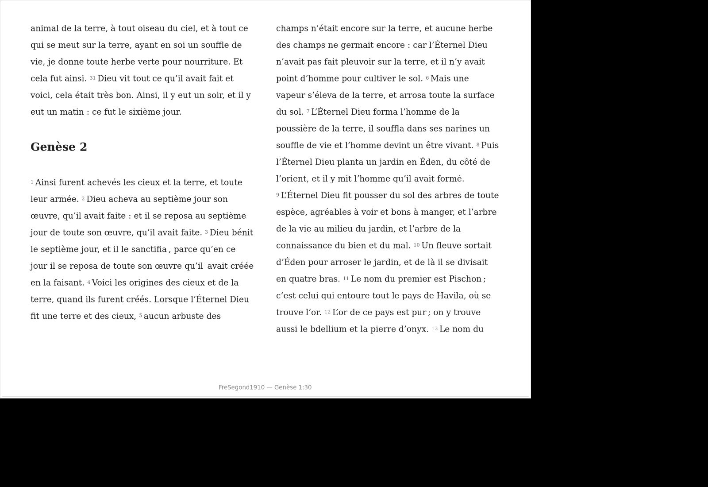

# Recovery and installed-package validation — 22 October 2026

## Restoration

The executor could reach GitHub through the inherited proxy (HTTP 200), fetch
the recovery commit and push a dedicated branch. No proxy bypass or network
policy change was needed. The management API still reported policy state
`unknown`; connectivity was established by actual requests.

Recovery commit: `66386c7a0e686befd0d797fc13f582be1649a701`.
ZIP SHA-256: `ac998aa44bc191b55380e06e74d8ad93110d3ba7456192a2649bfdf2f6c909c2`.
All archive checksums passed. The two mail patches were replayed with `git am`
from exactly `884591cd194bd7c07e3534a9b652c154a578dd34` on
`feat/24-recovered-gtk-validation`, preserving authorship.

| Original commit | Restored commit |
| --- | --- |
| `fa2bfa02f6aeb640f134bda0abf7f4a30a1e1911` | `cf762305ac4a8334c3baf1c549bc55ae0f26c262` |
| `dd48c3f56509079017c950582c49fc6cbe8304f6` | `c813b998aa8de25c3b2113889df8e4c9cfedd657` |

The restored tree and an independent index application of the cumulative patch
both produced `baf8a94e6b80f725157cf41a4c68f390e9b245e5`. Reverse-apply checking,
Python compilation and `git diff --check` passed. The recovery branch was not
merged. No task, local history, personal profile or signed channel was reset.
See [restoration identity](evidence/recovery-24/restoration.json).

The only subsequent changes are a GTK regression test for exit during active
preparation and validation documentation/evidence. Application code remains
identical to restored `c813b99` and to the installed candidate, byte for byte.

## Tests against source code

A disposable Debian trixie Docker environment supplied GTK 4.18, libadwaita 1.7,
SWORD 1.9, native Pango 1.56.3, Babel, Xvfb and actual X11 input libraries.

| Executed check | Result |
| --- | --- |
| Full unittest discovery, including exit during preparation | 175 passed, no skips |
| French UI/appearance/immersion/pagination/worker suites | 87 passed, no skips; overlapping coverage |
| Native reading, passage actions and popover scripts | Passed |
| Real Segond book preparation, exact SWORD words/display/copy partitions, headings, cache reuse, supersession and worker shutdown | Passed for Genesis, Mark and Luke |
| Offline GTK continuous-book and stabilized-UI checks | Passed |

Raw [full suite](evidence/recovery-24/source/full-suite-with-exit.log),
[French suite](evidence/recovery-24/source/french-suite.log),
[book measurements](evidence/recovery-24/source/book-preparation.json) and native
logs are retained separately from installed-package results.

## Tests against an installed Flatpak

A new candidate was built from the unchanged manifest and its pinned source
archives using GNOME SDK 49, exported, bundled and installed into a disposable
Flatpak user installation. This is an installed bundle test, not a source
overlay or only a builder-tree smoke test.

| Identity | Value |
| --- | --- |
| Application source | `c813b998aa8de25c3b2113889df8e4c9cfedd657` |
| Installed ref | `app/io.github.icfmp.Bible/x86_64/recovery-24` |
| Installed commit | `5e7ab679ab0c90529cf3a4bf499705f3057602608219bdf8b2200e00a02c63f4` |
| Bundle SHA-256 | `09f9bd98adcc5796d18038b207f132b6428ed3caf567f2fae0304c2552f13fbe` |
| Runtime | GNOME Platform 49; GTK 4.20.4, libadwaita 1.8.8, Pango 1.57.1 |

[Runtime refs/commits](evidence/recovery-24/flatpak/runtimes.txt),
[build identity](evidence/recovery-24/flatpak/build-info.json),
[installed metadata](evidence/recovery-24/flatpak/installed-info.txt) and
[application file hashes](evidence/recovery-24/flatpak/installed-audit.json)
identify the actual tested code. Every application Python file matches the
source. No application files were overlaid into `/app` for testing.

All checks ran from outside the checkout with `flatpak run --unshare=network`.
`/app/lib/bible-python` preceded the read-only tools/tests checkout on
`PYTHONPATH`. The original resource profile was mounted read-only; UI scripts
used separate disposable copies. Pillow was supplied on a separate test-only
path for screenshot tools; its [wheel hash](evidence/recovery-24/test-tools.json)
is recorded. It is not an application dependency added to the bundle.

| Executed installed-package check | Result |
| --- | --- |
| Affected French native suites: worker/pagination/immersion/UI/providers/library/references/notes/session/highlights/direction/synchronization/appearance/actions/commentary | 125 passed, no skips |
| Native click-to-note/context-copy immersion test on an isolated display | 1 passed |
| Read-only book preparation with `--require-packaged` | Passed: Genesis, Mark, Luke; 3,363 actual verses checked against direct SWORD reads |
| GTK continuous books with `--require-packaged` | Passed: 212 Genesis pages, 38 chapter headings continuing inside pages; exact partition and reflow anchor |
| Stabilized UI with `--require-packaged` | Passed: uniform day/night/high-contrast drawer, single shared Aa, safe-margin arrows, pointer/keyboard focus, F10/popover/Escape lifecycle |
| Native reading, exact partial selection/copy/actions, nested popovers | Passed |
| Installed application/source hash equality and original test-resource hashes | Passed |

The [125-test log](evidence/recovery-24/flatpak/affected-suite-with-exit.log) and
[import manifest](evidence/recovery-24/flatpak/affected-suite.json) establish that
the application imports came from `/app/lib/bible-python/bible`. The isolated
native-click test is separate because Xvfb belongs to the test host, not the
runtime. Unit fixtures are explicitly synthetic; real-resource evidence is
[recorded separately](evidence/recovery-24/flatpak/book-preparation.json).

The packaged continuous-book sample recorded 67 GTK heartbeat callbacks during
1.69 seconds of initial preparation, with a largest gap of 0.486 seconds. This
proves main-loop activity, not a hard responsiveness/latency guarantee. GTK
allocation/snapshot and incomplete headless portal warnings remain in raw logs;
no assertion failed in the final runs.

The initial harness attempts stopped before meaningful app checks because the
private checkout/scripts were unreadable after sandbox privilege dropping.
A readable disposable checkout fixed that without changing the app. The native
actions tool also rejected a pre-created empty profile; a new profile under a
separate allowed test directory passed. These setup errors are not counted as
passing app tests. Original diagnostics remain in the execution workspace.

The source probe used English headings; packaged probes used French headings.
Their document/copy hashes therefore differ with localized book titles. Both
independently verify every source verse and exact partitioning.

## GTK captures

These are actual installed-package GTK/X11 captures under Xvfb. The black area
outside the window is the virtual display, not the application's reading palette.
Xvfb without a GNOME compositor does not prove effective GNOME fullscreen.

[Pointer focus](evidence/recovery-24/flatpak/stabilized-immersion-pointer.png),
[keyboard controls](evidence/recovery-24/flatpak/stabilized-immersion-keyboard.png),
[day](evidence/recovery-24/flatpak/stabilized-drawer-day.png),
[night](evidence/recovery-24/flatpak/stabilized-drawer-night.png) and
[high contrast](evidence/recovery-24/flatpak/stabilized-drawer-day-contrast.png)
provide additional evidence.

## Reproduction and remaining gates

The [harness scripts](evidence/recovery-24/harness/) retain the exact build and
check commands. They expect `/src` as the read-only source checkout, `/evidence`
as a writable test-output mount, and `/validation` as disposable working space.
The source container needs GTK/SWORD/Babel/Xvfb/Flatpak and the inherited proxy
and trusted session CA. The package harness uses a readable copy of `bible`,
`tests` and `tools` under `/validation/checkout`; application imports still resolve
from `/app` first. Use new profile paths when repeating mutating UI checks.
The final source suite and affected package suite were rerun after adding the
exit-during-preparation regression test. Other package probes use the same
unchanged installed application.

The candidate bundle, SHA-256 and build-info are available locally under
`/workspace/bible-validation-artifacts/`. This is a test artifact, not a release
or an alpha-channel update. The GitHub Actions run on the restored source is
[39757697373](https://github.com/icfmp/Bible/actions/runs/39757697373); its result
is not inferred from local tests. Follow the PR checks for the final branch.

Manual GNOME/Wayland fullscreen/restore, physical gestures, screen-reader
accessibility, real desktop portal behavior and client acceptance remain open.
The current evidence does not establish those acceptance gates. This task does
not claim nine fresh resource installations, eight comparison configurations,
signed update verification or a new public alpha. Historical saved results are
not counted as fresh tests.

**#24 stays open. #57 has not resumed**, in accordance with the requested order.
Its verified cross-versification mapping inputs and representative installed
modules remain separate work described in the restored offline report. No issue
is closed by this PR. No release, Flathub submission, signing key, signed alpha
ref, channel configuration or public site was changed.
