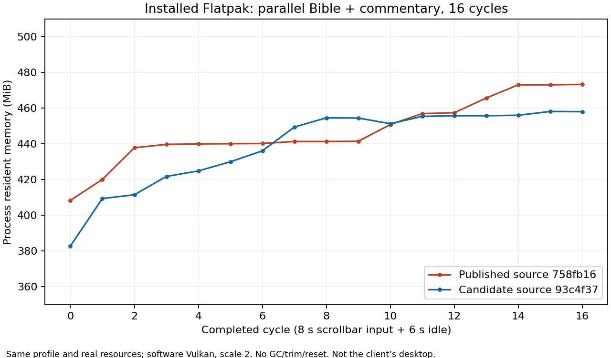

# Installed-alpha CPU and memory investigation — 26 October 2026

Status: a targeted correction is delivered in signed alpha **40355737256-2**, source `67d741f989da6d6a227af47e5296a93da6f5b33e`; the severe client-specific regression is **not yet fully reproduced or accepted as resolved**. Graphical finishing and numbered release #87 remain paused. The client has requested resuming #26 after this verified delivery, separately. Client data is not available in the cloud environment and has not been reset or changed.

The client reports approximately 700–762 MB at startup, a logical CPU saturated after the first mouse-wheel or native scrollbar gesture, later 1.91 GB, and a temporary GNOME unresponsive warning. Their startup configuration is one tab with comparison and Study open together, with maps/references/other optional study resources installed. They cannot currently confirm the selected Study tool. Translation, passage, scale, GPU/driver and exact installed commit remain unconfirmed.

## Verified published inputs

| Input | Source | Signed alpha | Signed OSTree commit | Verified original CI bundle |
| --- | --- | --- | --- | --- |
| Previous | `7a633f3281d0a6086cb822a1ac9f055beb53445b` | 40221899923-2 | `56d9a5cb2c52d41f7218ec4345aca46530787b5b5974bb56c652cdad7a9013b6` | [40220519597](https://github.com/icfmp/Bible/actions/runs/40220519597) |
| Current | `758fb1600b00027b47ac0f4998f34bed6806d8e5` | 40267227219-2 | `d0d8a6309e3f75d87e1892d23c3f2efd2c99843e44a8c60fffdb1a8a87de33ce` | [40265503566](https://github.com/icfmp/Bible/actions/runs/40265503566) |

Previous bundle SHA-256: `c31ece2a487e61eecb7fbf0d158ce859501b589fffccd8754d2c21f193031a57`. Current bundle SHA-256: `d8d5eeb9ca0e9349d2b7fe36dfc7ebe8a96e4993997678e6437c0f396b5f3b87`.

The initial A/B/previous-repeat uses actual signed public alpha installs. After two HTTP 503 failures fetching the public repository in later jobs, extended diagnostics install the verified original CI master bundles whose application code was imported into the corresponding signed alphas. These are distinct test scopes; CI refs are not described as signed-alpha installations. Candidate packages are feature-branch CI refs until a signed deployment and update are separately verified.

## Measurement method

Each test uses actual `/app/lib/bible-python` imports and records their paths/hashes and GTK renderer. A persistent disposable profile contains real downloaded translations and a real validation note. It is retained across version switches and repeated cycles. No forced garbage collection, allocator trimming or profile reset is performed. Four real SWORD resources are used: FreSegond1910, FreBDM1707, KJV and Wesley.

An independent XTest process sends sustained input at approximately 100 Hz, with repeated direction changes. It samples process-wide CPU and `/proc` RSS/PSS/anonymous memory every 200 ms. **100% CPU means one logical CPU**, equivalent to approximately 25% total on a four-thread machine. CPU includes native renderer workers. Memory is process resident memory, not GPU VRAM or an unspecified desktop monitor's application/cgroup total. Values below use MiB (1,048,576 bytes).

An initial six-second idle period is followed by eight seconds of input and six seconds after stopping, repeated without restarting the process. A passive frame-clock after-paint observer does not add a tick. The GTK heartbeat runs every 50 ms, so its maximum interval includes the normal 50 ms polling period. Adjustment timestamps prove viewport movement independently of frame-clock observations; later reports also record first movement/paint, first visible-toolbar dismissal and adjustments later than 500 ms after release.

Python cProfile/tracemalloc and native-allocation profiling are separate diagnostic runs: their amplified timings are not used as decisive consumption or responsiveness measurements. Native CPU sampling must target the actual packaged Python process, not Flatpak's sandbox init/wrapper. A successful workflow step alone does not establish usable profiling data.

## Before application changes

Full selected summaries, including per-cycle RSS/PSS/anonymous memory and CPU, are in [baseline-summaries.json](baseline-summaries.json). Raw samples and logs are retained in the linked workflow artifacts.

| Installed scenario | Previous startup → final RSS | Current startup → final RSS | Scroll CPU, one core |
| --- | ---: | ---: | ---: |
| Signed alpha, scale 1, 14 pt, Psalm 119, four cycles | 332.0 → 343.6 MiB | 303.0 → 344.8 MiB | roughly 33–38% |
| Exact CI bundles, scale 1, 24 pt, FreBDM Genesis 6, twelve cycles | 329.6 → 371.7 MiB | 299.1 → 366.4 MiB | roughly 24–30% |
| Exact CI bundles, scale 2, 24 pt, native scrollbar, eight cycles | 379.5 → 392.5 MiB | 350.0 → 409.0 MiB | roughly 105–108% for both |

The signed previous-repeat ends at 322.9 MiB. Scale-two first scrollbar movement is approximately 3.7 ms and first paint approximately 5.7 ms in both sources. The developer environment can reproduce a saturated logical CPU while scrolling at scale two with software rendering in both published builds. Those initial runs did not reproduce the client's 1.91 GB or multi-second hang; a later isolated four-second wait is documented below. These findings do not identify the client's GPU/renderer or establish that their reported regression is absent.

Signed A/B: [40289934685](https://github.com/icfmp/Bible/actions/runs/40289934685), artifact 12635478798, SHA-256 `db1e3fe915a416bc63121b1e7e21436ebbc7a108735cc9603ef0f9749b3e9924`. All nine measurements succeeded; the job failed a receipt-only list/tuple normalization assertion. That assertion was corrected, not relaxed, in later preservation checks.

Extended/native: [40293965351](https://github.com/icfmp/Bible/actions/runs/40293965351), artifact 12637278581, SHA-256 `965080e55141ece17e85690a3c7f405f8f1a0ea573841e307455d0c6855c1e52`. Consumption, native allocations and normalized preservation succeeded; native CPU sampling failed before recording because the executable search did not follow a symlink.

Scrollbar/scale two: [40296371345](https://github.com/icfmp/Bible/actions/runs/40296371345), artifact 12639245927, SHA-256 `e3d71fa92b6bcb4b216249d4af2f3dfdde66feb853d51b4157383d2837b56095`. Consumption, native allocations and preservation succeeded. The old perf step targeted a sandbox wrapper and used an unsupported `tid` sort key; its output is **not a valid native CPU profile**.

## Measured work addressed by the candidate

- Three permanent layout ticks execute even when geometry and content are unchanged. Native geometry/adjustment/appearance invalidations now request bounded settling and stop on unmap. Reader anchors, comparison alignment, sidebar resizing and caption adaptation remain active.
- Following a verse with Study open repeatedly parses the same translation configurations and provenance. A separate Python profile counted 212 resource metadata reads for two semantic updates. The immutable results are now stored in a standard bounded LRU of 128 entries; both file revisions invalidate the result. Completeness, removal and source identity checks remain active. No Reader or Library object is retained by this cache.
- The closed passage selector rebuilds book/chapter/search widgets during verse following. Defer those rebuilds until opening, while retaining initial and tab/source context updates and forced refresh on opening.
- Already-hidden selection actions avoid repeated native popdown/backdrop teardown; delayed selection capture still gets cancelled.

These changes target measured unnecessary work. They do not justify claiming the client's severe memory regression is resolved before installed candidate measurements and desktop acceptance.

## Blur and allocations

Signed-alpha runs with the toolbar initially visible compare native blur, radius zero and the complete backdrop disabled in the test process only. Scroll CPU remains approximately 31–36% of one core; no basis was established to attribute the reported regression to blur. Hidden toolbar profiles show no continuing backdrop snapshot/invalidation/layout work. Candidate tests separately measure the first dismissal transition. Blur rendering and preferences are unchanged by this correction.

Python traced memory in the separate baseline profile is about 13–15 MiB, much less than total RSS. Native memray stacks identify retained Vulkan/llvmpipe swapchain, JIT, GSK node processor and shader caches. Retained caches at tracker/process end are not by themselves proof of a leak. Instrumented memory/time overhead is explicitly excluded from normal-run conclusions. No forced collection or cache purge is used to manufacture a plateau.

## Optional resource reproducibility

The final combined scenario includes STEP words, places/maps, OpenBible cross-references and topics. The live weekly topic archive changed and was correctly rejected by the published application's pinned checksum in runs 40302528970 and 40303071642; those runs stopped before measurements and preservation receipt creation. The application validation was not weakened. Tests now reuse the [attributed, previously validated installed topic index](fixtures/README.md), verifying both compressed and database hashes before first use. They preserve its bytes across all version switches/cycles, together with the other study databases, module files, reading preferences and note.

## Final candidate and normal installed results

Candidate [PR #133](https://github.com/icfmp/Bible/pull/133), source **`93c4f3766af03936d2637bf89fb307a01c59dadf`**. [Application CI 40335461969](https://github.com/icfmp/Bible/actions/runs/40335461969) is green: **330 source tests, 144 French UI tests, 138 installed-Flatpak tests and 11 installed immersion tests** (overlapping suites), plus installed OpenGL captures, sustained input, real resources/offline and study checks. The identical application code is now delivered at merge source `67d741f989da6d6a227af47e5296a93da6f5b33e`; see the signed delivery below.

The later native trace identified a fourth permanent callback in Study: `adapt → anchor → visible_section → gtk_text_layout_get_iter_location`, retaining tens of MiB of offscreen text layouts. Study now settles only after actual geometry/content/adjustment changes and cancels synchronously when hidden. Reader viewport following similarly resolves the top display line and adjacent verse starts instead of requesting positions for every offscreen verse. GTK oracle tests compare the original first-visible/fallback behavior across wrapped/partial lines, LTR/RTL and two widths. The final native peak report no longer contains the former large Study/visible-reference layout stacks among its 30 largest groups.

Canonical reference handling also reconstructed all 85 normalized French book aliases for every lookup. A static alias table preserves all 260 checked French/case/OSIS variants. Separate source cProfile counts without tracemalloc changed from 20,157 canonical lookups / 1,733,569 normalizations to 28,952 / 29,104. These diagnostic counts are not installed performance timings; GI/thread cumulative wall times are not interpreted as CPU.

The decisive matrix below is **uninstrumented**, except for the passive 50 ms heartbeat, after-paint observer and independent 200 ms process sampler. Scale two, 24 pt, very-airy/narrow, 1180×780, real FreSegond1910 Psalm 119 / KJV / Wesley; all four optional study databases remain installed. Vulkan/llvmpipe is software rendering under composited X11/Xvfb with GTK 4.20.4 / GNOME 49. Core matrix uses `GTK_A11Y=none`; the native bridge comparison is recorded separately below. Reading settings and the profile are identical between versions. Startup is measured after the scripted real-resource ready condition; it is not a cold-machine startup benchmark.

| Normal installed scenario | Current → candidate startup RSS (MiB) | Current → candidate final RSS (MiB) | Scroll CPU, current → candidate (% one core) | Mean post-stop CPU, current → candidate | Max heartbeat, current → candidate |
| --- | ---: | ---: | --- | ---: | ---: |
| Parallel + Study, scrollbar, 8 cycles | 386.4 → 380.8 | 462.3 → 429.2 | 108.3–111.7 → 109.3–115.9 | 8.1 → 3.9 | 179.5 → 78.2 ms |
| Parallel + Study, wheel, 4 cycles | 384.9 → 381.1 | 437.1 → 431.1 | 106.6–107.3 → 108.3–109.5 | 11.2 → 6.9 | 192.5 → 93.5 ms |
| Parallel + Study, GL renderer, 2 cycles | 331.0 → 294.1 | 365.4 → 319.8 | 91.5–92.4 → 85.4–86.5 | 4.5 → 1.5 | 206.9 → 71.5 ms |
| Comparison, wheel, 2 cycles | 369.0 → 363.3 | 373.9 → 380.2 | 94.5–95.1 → 98.3–100.3 | 5.8 → 3.4 | 67.5 → 97.3 ms |
| Study, wheel, 2 cycles | 379.9 → 381.4 | 406.5 → 402.0 | 107.8–109.4 → 115.3–116.2 | 8.6 → 5.3 | 150.5 → 101.0 ms |
| Single, wheel, 2 cycles | 351.5 → 360.5 | 373.2 → 373.9 | 83.7–86.7 → 81.9–82.2 | 4.7 → 4.0 | 322.8 → 93.3 ms |

These results show reduced redundant work and several improved responsiveness/memory measurements. They **do not show an overall CPU reduction while scrolling in combined Vulkan mode**; comparison-only memory and responsiveness also vary adversely. Do not compare endpoints across different renderers/cycle counts as if they were the same workload. The client's 700 MB startup and 1.91 GB usage remain unreproduced, not disproved or resolved.

### Extended cycles and the isolated wait

[Sixteen combined cycles](https://github.com/icfmp/Bible/actions/runs/40341245220), approximately four minutes per build: current startup 408.4 → final 473.4 MiB, candidate 382.8 → 458.1 MiB. Scroll CPU 105.2–109.2 → 108.4–114.6% of one core; mean post-stop CPU 8.5 → 3.9%; maximum heartbeat 191.7 → 91.2 ms. Candidate cycle endpoints finish around 455–458 MiB; the observation is too short to prove the absence of a long-session leak. No GC, allocator trim or restart is used to create a plateau.

[CSV](combined-16-cycles.csv) · [Selected full phase summaries and provenance](final-measurements.json).

The broad matrix's **single-reader scrollbar** candidate case has one unexplained **4.238 s** heartbeat interval, spanning idle and the beginning of the second gesture. External sampling continued; process CPU remained exactly 8.18 seconds and RSS approximately 379.9 MiB during the gap. That rules out sustained CPU execution in that process during the observed interval; it does not identify the wait or prove it harmless. The other seven cycles stayed under 75 ms. This outlier is retained and is not presented as a pass with all gaps below 100 ms.

A dedicated [16-cycle single-reader repeat](https://github.com/icfmp/Bible/actions/runs/40347119859) adds independent process-state and wait-channel sampling. The gap did not recur: current max heartbeat 92.2 ms, candidate 94.9 ms; current startup/final 379.2/425.5 MiB versus candidate 351.3/392.4 MiB. Scroll CPU 79.4–84.3 → 71.6–76.8% of one core; post-stop 2.1 → 0.7%. The original four-second interval remains unexplained. Full records remain in the workflow artifact; selected receipts were read through [40348406952](https://github.com/icfmp/Bible/actions/runs/40348406952), which verifies the downloaded digest. Local access to that artifact's Azure storage host was refused.

Every normal broad/extended/repeat case records **zero adjustment changes later than 500 ms after input release**. Input includes sustained movement and repeated direction changes. Timing and adjustment/frame observations do not substitute for physical-display input latency or manual acceptance on the client's GNOME session.

### First menu transition and blur

With the selection bar initially visible, the first native wheel event hides/releases it in 0.327 ms before and **0.411 ms after**; candidate first reader movement **0.914 ms**, first GTK after-paint **11.909 ms**. Final hidden state has no backdrop or placement tick. The separate Python trace records no hidden backdrop snapshot/invalidation/placement work (only two unrelated outside-click handler calls).

Candidate native blur versus diagnostic backdrop disabled gives 81.8–82.6 versus 81.4–83.0% of one core during single-reader wheel scrolling. This does not identify blur as the cause; rendering remains GTK/GSK and the production blur is unchanged. The new correction adds no custom texture cache or rendering worker. Python tracemalloc and memray strongly amplify execution times; their stalls/RSS are excluded from the normal table.

### Native CPU and memory attribution

[Final CPU/native mappings](https://github.com/icfmp/Bible/actions/runs/40335488708) samples the actual packaged Python process: 962 current / 690 candidate user CPU-clock samples, zero lost. `_PyEval_EvalFrameDefault` accounts for 8.32% → 2.46% of samples; renderer worker execution remains material. This is one sampled interval, not a precise estimate of total saved CPU or a client GPU profile.

In that separate run, final RSS is 454.7 → 415.5 MiB. Resident maps comprise approximately 259.0 → 213.8 MiB anonymous, 62.5 → 62.8 MiB shared buffers, 129.9 → 127.8 MiB runtime libraries and 3.4 → 3.3 MiB other mappings. Anonymous memory includes Python/native heaps and possible SQLite allocations; absence of mapped database files does not imply zero database memory. This supports attributing memory instead of equating resource download size with RAM.

[Final native allocation trace](https://github.com/icfmp/Bible/actions/runs/40342164691) identifies a 56.38 MiB software Vulkan swapchain group, 10 MiB JIT group, and GSK/shader caches. The former large Study/viewport text-layout groups are absent from its top 30 peak groups. Retention at tracker end alone does not prove a leak. The first native attempt stopped on the old baseline's four-second readiness ceiling under tracer overhead; only the tracer wrapper's unchanged readiness condition was allowed up to 120 seconds for the retry. Ordinary tests/timing limits were not relaxed.

### Historical previous/current comparison with the clarified workload

The [historical combined A/B](https://github.com/icfmp/Bible/actions/runs/40339570052) uses both original published CI bundles and the same current runtime, resources/profile and eight scrollbar cycles. Previous source `7a633f3`: 398.4 → 432.5 MiB; current `758fb16`: 379.6 → 459.9 MiB. Scroll CPU is 105.4–109.4 versus 105.7–109.9% of one core, maximum heartbeat 171.6 versus 165.9 ms, and no late adjustment changes. This reproduces high software-rendering CPU in both versions and more retained memory in the newer one, but not the client's 1.91 GB or reported GNOME warning. Earlier installed runtime/driver changes cannot be reconstructed from these same-current-runtime tests.

### Accessibility comparison

The first active-bridge attempt [40344271694](https://github.com/icfmp/Bible/actions/runs/40344271694) failed before the active measurement because the runner lacked `org.a11y.Bus` (`ServiceUnknown`). The [successful repeat 40348923376](https://github.com/icfmp/Bible/actions/runs/40348923376) installs the native AT-SPI service and records `IsEnabled=true`, `ScreenReaderEnabled=false` for both builds, with `GTK_A11Y=atspi`; both logs confirm registry activation requested by the Flatpak D-Bus proxy. Application accessibility is unchanged.

| Parallel + Study, two scrollbar cycles | Startup → final RSS | Scroll CPU (% one core) | Post-stop CPU | Max heartbeat |
| --- | ---: | --- | ---: | ---: |
| Current, diagnostic bridge disabled | 398.6 → 459.8 MiB | 107.1–109.4 | 10.0% | 216.9 ms |
| Candidate, diagnostic bridge disabled | 381.8 → 409.8 MiB | 110.6–111.2 | 3.3% | 109.6 ms |
| Current, native bridge enabled | 382.8 → 433.7 MiB | 108.0–108.4 | 11.7% | 196.9 ms |
| Candidate, native bridge enabled | 381.6 → 416.0 MiB | 109.3–114.1 | 4.5% | 135.0 ms |

Candidate with the native bridge: first motion 2.683 ms, first GTK after-paint 4.527 ms; no adjustment changes later than 500 ms. The bridge adds some cost but does not reproduce the reported 700 MB/1.91 GB here. No Orca/screen-reader client or real GNOME shell is simulated; headless portal/device warnings remain. This short run does not establish desktop accessibility performance. Ordinary source/packaged functional checks do not set the timing harness's diagnostic `GTK_A11Y=none` switch. All preservation receipts pass.

### Preservation, provenance and remaining validation

Broad, extended, historical, CPU/native and single-repeat jobs pass preservation checks: the real validation note, saved reading-preference bytes, 37 downloaded module files and all four optional study SQLite database hashes survive version switches and cycles. This verifies a real disposable developer profile, not the unavailable client's private data. The original working tree's issue #26 research remains untouched.

| Final evidence run | Artifact | ZIP SHA-256 |
| --- | --- | --- |
| [Broad matrix 40335294312](https://github.com/icfmp/Bible/actions/runs/40335294312) | 12660365526 | `4fc70983125c1bf523f817960819d97969e60a7bc423a2734a6ecaeaefe23355` |
| [Combined 16 cycles 40341245220](https://github.com/icfmp/Bible/actions/runs/40341245220) | 12659521468 | `bc18dbf8242ba528491b757ce4a86744c73802af77d8a2bb352d98e722211121` |
| [CPU/maps 40335488708](https://github.com/icfmp/Bible/actions/runs/40335488708) | 12658780986 | `e1c1603c0804960b04f8fb4f1e4297c7b849697cce79b2195527c44a3ef2fbe8` |
| [Native allocation 40342164691](https://github.com/icfmp/Bible/actions/runs/40342164691) | 12660955043 | `fab19acbf8cf4ac33fa5e7df80d1c245ccf2b031c90acdd0e8b7945b4c8fc8d6` |
| [Historical A/B 40339570052](https://github.com/icfmp/Bible/actions/runs/40339570052) | 12658947928 | `84d9080c1cd86716ad0676559be906a7176329f9a0e557d237d748552657853f` |
| [Single wait repeat 40347119859](https://github.com/icfmp/Bible/actions/runs/40347119859) | 12661589775 | `cf89b848bb3bf05a900f2e3880131f2b022a99caa7263098593f89e26c2113e9` |
| [Accessibility 40348923376](https://github.com/icfmp/Bible/actions/runs/40348923376) | 12663491251 | `0aa6f9ba43cdd17833f07dc9b28d94f9f31c50c1310cd1b48d5a1df654d7876d` |

Native perf raw stack files remain private to the runner temporary directory; public artifacts contain symbolized reports and summaries. A receipt-only baseline assertion failure, rejected live upstream checksum, profiling setup failures and the isolated normal-run wait are explicitly distinguished from usable measurements.

## Signed delivery and actual old-to-new update

[Main CI 40350367815](https://github.com/icfmp/Bible/actions/runs/40350367815) passes the same 330/144/138+11 suites and installed visual/native/resource checks. [Signed publication 40355737256](https://github.com/icfmp/Bible/actions/runs/40355737256) is green; canonical alpha **40355737256-2**, source `67d741f989da6d6a227af47e5296a93da6f5b33e`, OSTree `49e1338d582f849bcee75aa2c025294955aba2d9f5aef985f300620995ca5445`. The application/test/tool/package files are identical to tested candidate `93c4f37`.

[Cross-version signed update 40350780587](https://github.com/icfmp/Bible/actions/runs/40350780587) actually installs old signed `d0d8a630…`, prepares real data once, measures it, then uses ordinary `flatpak update` to install new signed `49e1338d…` with the same profile. Origin `bible-alpha`, ref and fingerprint `47A17230403EA4953745E6E020EB9FFCCECAFD8F` are unchanged. No CI bundle is substituted for this delivery check.

| Actual signed-channel case | Startup → final RSS | Scroll CPU (% of one core) | Mean post-stop CPU | Max heartbeat |
| --- | ---: | --- | ---: | ---: |
| Old alpha, combined scrollbar, four cycles | 399.7 → 475.0 MiB | 107.4–110.8 | 13.0% | 210.3 ms |
| Updated alpha, same combined case | 381.1 → 423.0 MiB | 110.6–113.3 | 6.3% | 106.4 ms |
| Updated alpha, single wheel, two cycles | 358.8 → 362.7 MiB | 102.8–103.9 | 4.6% | 66.1 ms |
| Updated alpha, comparison wheel, two cycles | 367.7 → 394.3 MiB | 113.0–113.1 | 5.6% | **416.2 ms** |
| Updated alpha, Study wheel, two cycles | 380.0 → 453.9 MiB | 112.7–116.2 | 7.6% | 156.6 ms |

First combined movement / GTK after-paint improves from 12.77/29.67 to 3.05/5.12 ms. All five cases have zero adjustment changes later than 500 ms after release. Comparison's 416 ms heartbeat is retained explicitly; these tests do not prove uniformly imperceptible latency. Combined scrolling still uses approximately one logical CPU on software Vulkan. These are bounded improvements, not proof that the client's 700 MB/1.91 GB or GNOME warning is cured.

The same actual signed-upgrade profile preserves its note, reading preferences, all 37 module files and all four study database hashes (no differences). Independent delivery verification also checks the public signed install/update receipts, exact package hash, all **347 corresponding project files**, three original dependency-source hashes, all **39 historical source records unchanged** (40 now), and no numbered-release change. [Delivery receipt with phase data and limits](delivery.json).

The first publication run `40353650158` failed its public install with HTTP 503. Its retry then failed because Pages found duplicate same-named deployment artifacts across attempts. A fresh publication reused the already verified package and passed all checks; neither failure is counted as a complete delivery. No application rebuild or disabled verification was used for the retry.

Update: `flatpak update --user io.github.icfmp.Bible//alpha`. [Installation channel](https://icfmp.github.io/Bible/alpha/Bible.flatpakref).

Remaining acceptance: the client's actual GNOME/Wayland/driver/fractional-scale session, unexplained startup/long-session discrepancy and isolated waiting interval. Numbered release #87 stays paused, and issues remain OPEN. Project 5 access remains refused (`Resource not accessible by integration`); retain **In review** under the existing paused-numbered-publication workflow, with no Done/closure. The next functional task #26 resumes separately at the client's request; this delivery makes no assertion of completed #26 work.

## Optional client-side read-only capture

When the client is back at their computer, [collect-client.py](collect-client.py) can optionally record the existing running Flatpak without changing the profile. It captures version/GPU IDs, selected graphics environment settings, process RSS/PSS/high-water memory and CPU/thread counters. When available it separately records the Bible-specific cgroup memory/file cache, allowing comparison with a desktop monitor's app total. It records no notes/preferences/translation text, full environment, host name or network traffic; no sudo or overwrite is used.

Example after downloading/reviewing: `python3 collect-client.py bible-performance.json --seconds 120`, with Bible idle briefly, then wheel/scrollbar movement and reversals, then idle. The helper's parser and own-process `/proc` reads were smoke-checked; it has not been verified on the client's Flatpak. The client is currently away, so this is not treated as a prerequisite for continuing developer work or a reason to reset their profile.
