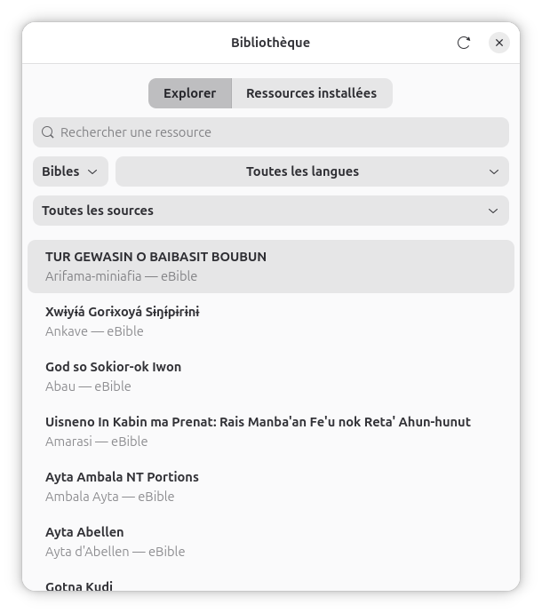
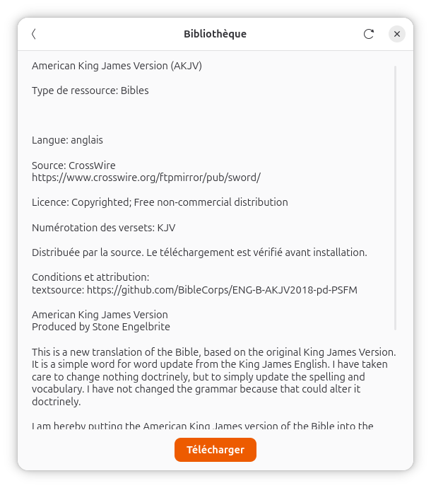
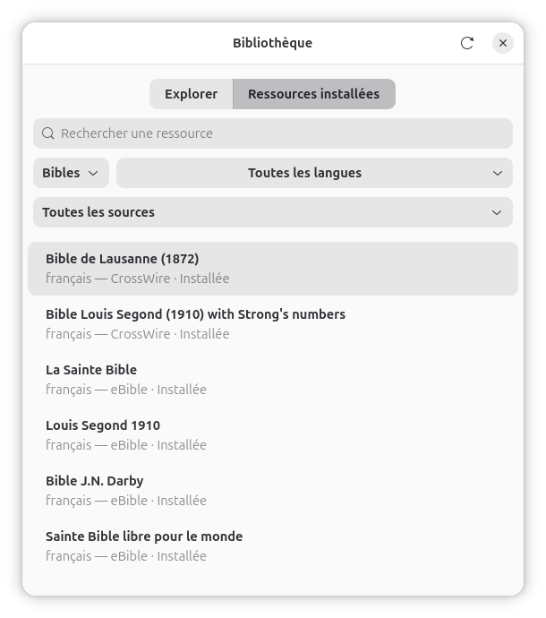

# Downloading Bibles and commentaries

Bible lets you choose the Bible translations and study resources you want to use. **No Bible text or commentary is bundled with the application**: you download resources from the Library, then use them offline.

> Each provider resource retains its own conditions and attribution. Catalogue availability does not grant permission to download, convert or redistribute it. Review the source conditions before confirming a download.

## 1. Explore the Library

Open **Library** with `Ctrl+L`.

The Library has two tabs:

- **Explore** — browse and search resources offered by the available catalogues.
- **Installed resources** — find the resources you have already downloaded.

The catalogue can contain resources in many languages, so filtering is often the easiest place to start.

*Browse available resources and narrow the catalogue using the filters.*

## 2. Find a translation or commentary

In **Explore**, use the controls above the resource list:

| Control | What it does |
| --- | --- |
| **Search** | Find resources by name or other available catalogue information. |
| **Resource type** | Switch between Bible translations and commentaries. |
| **Language** | Narrow the list to the language you want. |
| **Source** | Limit results to a particular resource catalogue. |

Choose a language first if the list is very long. You can then search for a familiar translation or commentary.

Each list entry shows a resource name and identifying information, including its language or source where available.

## 3. Download a resource

1. In **Explore**, find the translation or commentary you want.
2. Select it to inspect the information the Library provides.
3. Review its description, attribution and license.
4. Use the available download action to install it.

*Check a resource's information before downloading it.*

The exact detail and download controls may change while Bible is in alpha. Only download resources whose terms you accept.

### Download several resources

Request another resource while the current one is running. Bible uses one shared
queue for Bibles, commentaries, study tools and supported module updates. Source
metadata and any required permission confirmation are checked before a request
enters the queue. Repeated requests for the same edition do not start another job.

The active resource stays active through preparation, conversion, validation and
installation. Download **100%** means only that its transfer has finished. Other
rows show **Queued**, and their download action lets you cancel that pending
request. The active resource uses the existing **Cancel** action at safe stages.
An error leaves that resource available for an explicit retry and the next queued
request continues.

You may browse, close Library or return to reading while requests run. Reopening
Library shows the same queue. Windows using the same library share its operation
queue; a resource must not be installed by two windows at once.

Closing the application pauses unfinished requests. On the next launch, choose
**Resume** explicitly; no queued resource transfer starts automatically. A
completed installation is discovered from its installed metadata instead of
being downloaded again. A changed edition, source condition or checked study
revision requires review rather than silently changing the queued request.

To check what is available locally, switch to **Installed resources**.

*Find resources already available on your computer.*

## 4. Read and study offline

Once a resource has been downloaded, you can use it without an internet connection:

- **Bible translations** provide the text for reading.
- **Commentaries** can be consulted in the study panel while exploring a passage.

Press `F9` to show or hide the study panel.

A commentary may not cover every book or verse. Text layout and verse references can also differ between resources.

## 5. Catalogue refresh and availability

The Library periodically refreshes its resource sources. During a refresh, you may see a message indicating that **cached resources remain available**. This does not mean your previously downloaded resources have disappeared.

If a resource is not listed, try checking the resource type, language and source filters. Availability depends on the catalogues currently supported by Bible; not every translation or commentary can be offered.

## Licenses and attribution

Bible currently offers resources intended for free and open distribution. **Each downloaded resource has its own license and attribution**, which you should review before using or sharing it. Support for more restrictively licensed resources may come later.

---

**Next:** [Reading and navigation](Reading-and-Navigation) · [Study panel and commentaries](Study-Panel) · [Troubleshooting](Troubleshooting)
